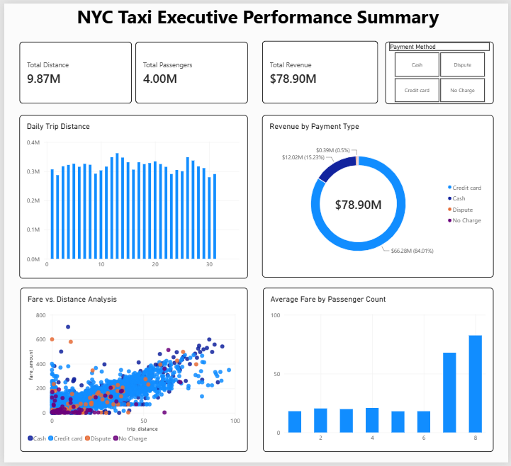
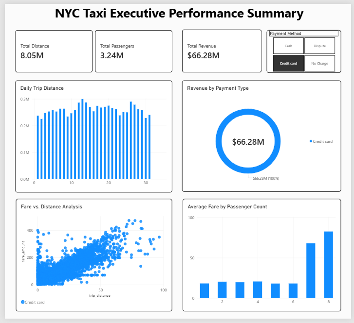
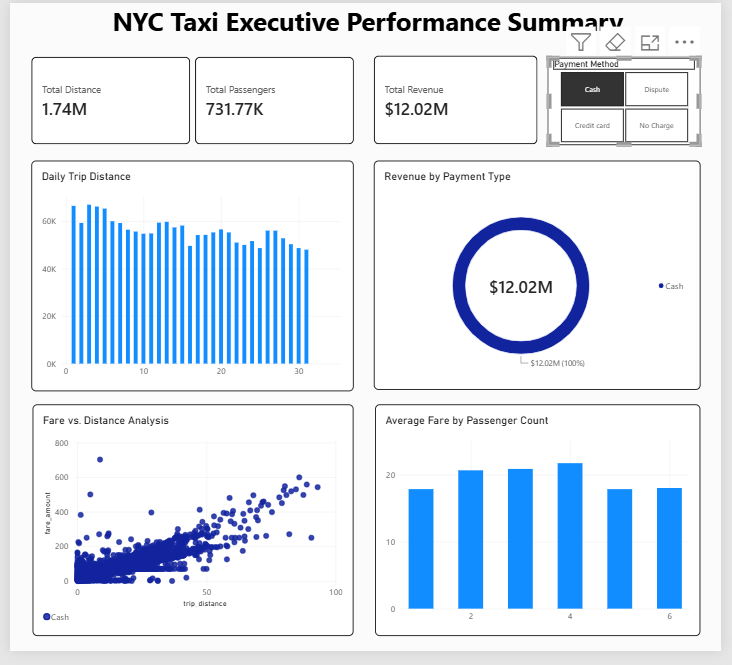

# NYC Yellow Taxi Trip Analytics (Jan 2023) 🚖

## Project Overview
An end-to-end data engineering and business intelligence project analyzing New York City Yellow Taxi trip records for January 2023. This project extracts a massive raw dataset, processes it through a Python-based ETL pipeline, loads it into a relational database, and visualizes key performance indicators (KPIs) in an interactive Power BI executive dashboard.

## Tech Stack
*   **Data Extraction & Processing:** Python, Pandas
*   **Database & Storage:** MySQL Workbench
*   **Data Visualization & BI:** Power BI
*   **Version Control:** Git & GitHub

## Executive Summary & Key Insights
The analytical dashboard processed millions of rows to reveal the following monthly metrics:
*   **Total Revenue:** $78.90 Million
*   **Total Passengers:** 4.00 Million
*   **Total Distance Covered:** 9.87 Million Miles
*   **Payment Preferences:** Credit cards overwhelmingly dominated passenger payments, accounting for **$66.28M (84.01%)** of total revenue, while cash payments made up $12.02M (15.23%).

## Dashboard Previews

### Main Executive View
*(Insert high-level KPI dashboard here)*


### Revenue by Payment Type Analysis
*(Insert breakdown of Credit, Cash, and No-Charge metrics here)*
| Credit Card Analysis | Cash Analysis | No Charge / Disputes |
| :---: | :---: | :---: |
|  |  |  |

## Data Architecture & Pipeline

1.  **Data Ingestion:** The raw data (`yellow_tripdata_2023-01.parquet`) is sourced from the official TLC Trip Record Data. 
2.  **ETL Processing:** `convert_parquet.py` utilizes `pandas` to read the columnar parquet data, calculate row counts, and transform it into a flattened CSV format for relational database ingestion.
3.  **Data Cleaning:** `data_cleaning_script.sql` cleanses null values, handles spatial mapping via `taxi_zone_lookup.csv`, and structures the tables in MySQL.
4.  **Visualization:** Power BI connects directly to the MySQL database via DirectQuery/Import to build the data model and render the KPIs.

## How to Reproduce this Project

Due to GitHub's file size limits, the raw Parquet and CSV files are not hosted in this repository. To run this project locally:

1. Clone this repository:
   ```bash
   git clone [https://github.com/YourUsername/NYC_Taxi_Project.git](https://github.com/YourUsername/NYC_Taxi_Project.git)